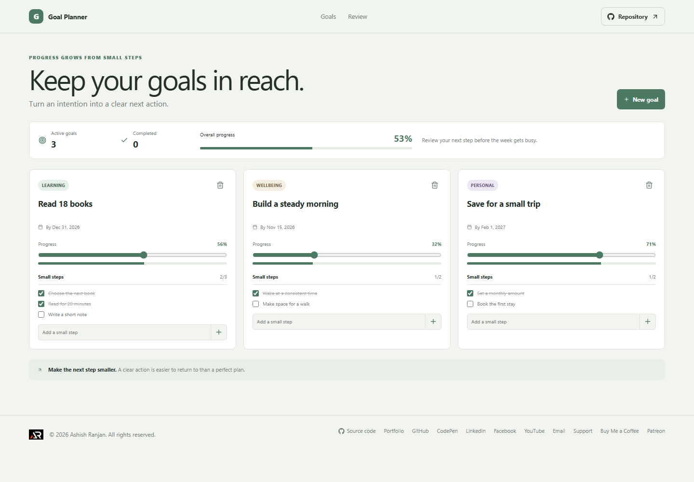

# Goal Planner

Goal Planner turns intentions into active goals with a target date, a progress measure, and small next steps.

## Interface

A progress summary sits above a set of goal cards. Each card shows its area, target date, progress slider, and milestone checklist.

## Features and use

Create a goal and choose an area and optional target date. Adjust its progress with the slider, check off milestones, and add steps as the plan changes. Remove a goal through the confirmation dialog.

## Data and limits

Goals and milestone states are saved in localStorage in this browser. There is no account or cross-device synchronization. Export is not currently included, so keep browser storage intact to retain the plan.

## Run locally

Use Node.js and npm, then run these commands from the project folder:

```sh
npm install
npm run dev
```

The app is built with React and Vite. Check the source and production build with:

```sh
npm run lint
npm run build
```

## Deployment

The public app is published with GitHub Pages at [https://a2rp.github.io/goal-planner/](https://a2rp.github.io/goal-planner/). To build and publish the current version, run:

```sh
npm run deploy
```

## Future improvements

Ideas that are not implemented yet:

- Goal templates, progress history, and JSON backup and restore.

## Links

- Portfolio: [https://www.ashishranjan.net](https://www.ashishranjan.net)
- GitHub: [https://github.com/a2rp](https://github.com/a2rp)
- CodePen: [https://codepen.io/ash1198](https://codepen.io/ash1198)
- LinkedIn: [https://www.linkedin.com/in/aashishranjan](https://www.linkedin.com/in/aashishranjan)
- Facebook: [https://www.facebook.com/theash.ashish/](https://www.facebook.com/theash.ashish/)
- YouTube: [https://www.youtube.com/@ashishranjan-ashz?sub_confirmation=1](https://www.youtube.com/@ashishranjan-ashz?sub_confirmation=1)
- Email: [mailto:ash.ranjan09@gmail.com](mailto:ash.ranjan09@gmail.com)

## Support

- Support: [https://a2rp-donation-page.netlify.app/](https://a2rp-donation-page.netlify.app/)
- Buy Me a Coffee: [https://buymeacoffee.com/ashishranjan](https://buymeacoffee.com/ashishranjan)
- Patreon: [https://www.patreon.com/ashishranjan](https://www.patreon.com/ashishranjan)